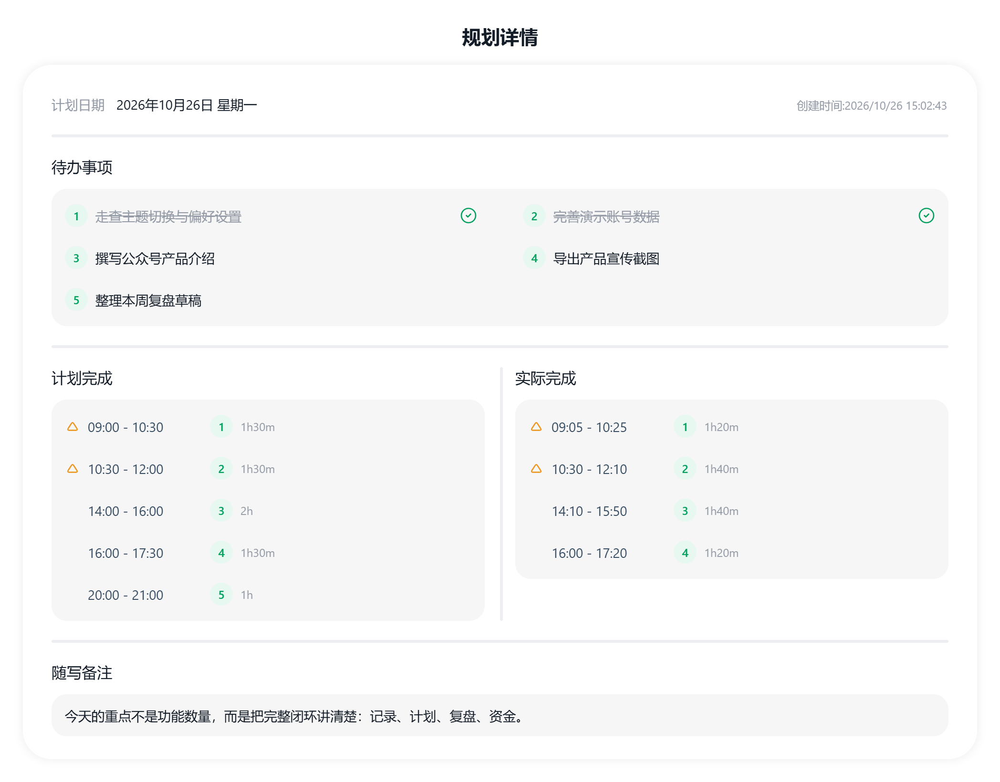
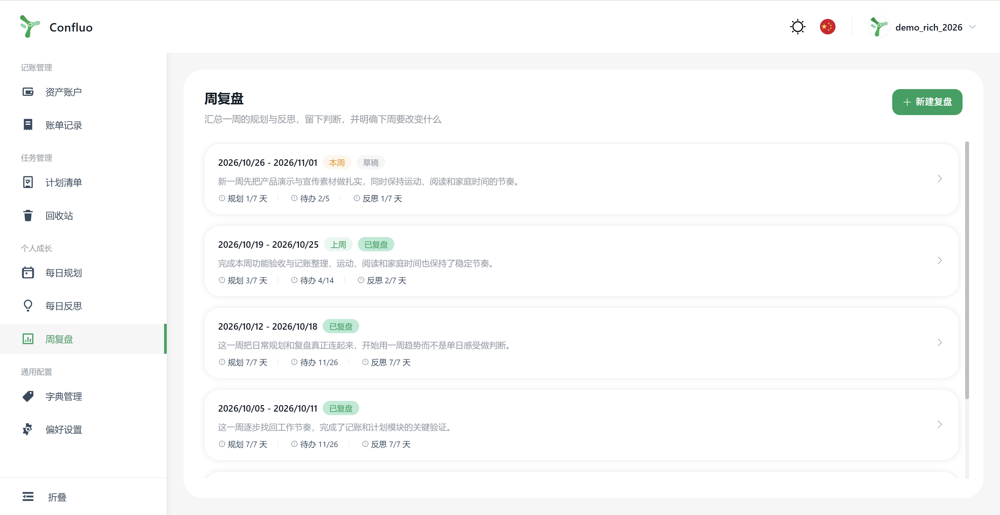
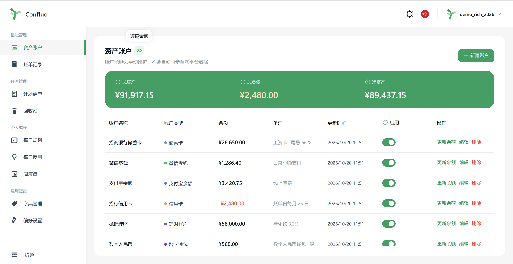
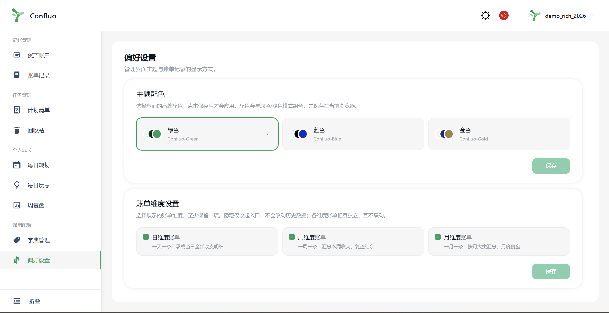

# Confluo：把计划、复盘和记账，放进同一套生活系统

> 记录不是为了给生活增加一份负担，而是为了在一天结束、一周结束时，更清楚地看见自己把时间、注意力和钱花在了哪里。

很多人会同时打开好几个工具：一个待办清单，一个日程应用，一个日记本，再外加一个记账软件。事情确实都被记下来了，但“今天为什么没完成”“这一周到底发生了什么”“这个月的钱去了哪里”仍然需要自己在几个应用之间拼图。

Confluo 想解决的，就是这种碎片化。

今天，Confluo 第一次正式与大家见面。

它是由一名程序员在 AI 辅助下独立设计、开发的一款个人工具系统。AI 提高了实现效率，但产品结构、交互逻辑、视觉规范和每一个细节的取舍，仍然由人持续判断和打磨。

它不是要把每一分钟都变成 KPI，而是把**目标、每日行动、反思、周期复盘和财务记录**放进一套连续的工作流里。你可以先记录，再观察；先看见真实节奏，再决定下一步怎么调整。

## 一条从“想做什么”到“看见结果”的完整路径

### 1. 用计划清单收住跨天、跨阶段的目标

计划清单适合承载那些不会在当天结束的事情：项目推进、学习计划、家庭安排、生活杂事。

每条计划都可以设置截止日期、标签和 Markdown 描述。筛选、搜索、完成状态和回收站也都在同一个页面里。它更像是一个长期目标入口，而不是又一个不断堆积的备忘录。

### 2. 用每日规划对照“计划”和“实际”

真正好用的日计划，不只是把待办列出来，还要知道自己原本打算怎么安排，以及最后实际做了什么。

Confluo 的每日规划把内容分成四类：

- 待办事项
- 计划完成
- 实际完成
- 随写备注

计划与实际各自记录起止时间，系统自动计算用时。一天结束后，你可以直接看出哪些事情被高估、哪些环节总被打断，以及临时插入的任务占用了多少时间。

*计划与实际并排呈现，能直观看到时间安排和真实执行之间的差异。*

规划详情还支持导出图片。对于需要做周报、项目回顾，或者习惯保存纸质记录的人来说，这让复盘结果更容易被带走和分享。

### 3. 每天留下几条真正有判断的反思

反思不是流水账。Confluo 把每条反思拆成三个部分：

1. 发生了什么；
2. 为什么会这样；
3. 下一次准备怎么做。

一天可以写多条，也可以只写一条。内容足够轻，才能长期坚持；结构足够清楚，才能让这些记录在之后真正被用上。

### 4. 到周末，用数据帮助自己回看

周复盘会自动汇总一周内的每日规划和每日反思，包括：

- 有几天做了规划；
- 待办完成情况；
- 计划用时与实际用时；
- 有几天写了反思；
- 每天是否留下记录。

这些数字不是用来给自己打分，而是帮助我们发现趋势。比如，连续几天计划得很满但实际完成偏少，问题可能不在执行力，而在任务估算本身就不现实。

*周复盘把散落在每天的记录收拢成一周视角。*

复盘内容分为“做得好的、挑战与卡点、本周收获、下周行动”。完成后会保存当时的统计快照，之后修改每日数据也不会悄悄改写历史复盘。

### 5. 把时间之外的生活成本也纳入视野

Confluo 的记账部分支持多账户资产和日、周、月三种账单维度。

资产账户可以区分储蓄卡、信用卡、微信零钱、支付宝、理财、现金等类型。总资产、总负债和净资产会集中展示，信用卡欠款则以负数参与统计。

*资产余额采用手动维护的快照方式，避免制造“自动同步一切”的假象。*

账单支持用户自定义收支分类和标签，明细可以关联具体账户，也可以从日、周、月三个独立视角查看。对于自由职业者、个体经营者，或者只是想重新理解消费结构的人来说，这种“既看流水，也看资产”的方式会比单纯记一笔支出更完整。

## 我们更在意的几件事

Confluo 的亮点不在于堆了多少功能，而在于让原本分散的记录真正形成一条可以回看的线。除此之外，我们也在坚持一些看起来不那么“显眼”的产品原则。

### 不用 KPI 定义一天

效率工具很容易变成另一种压力来源：完成率、连续天数、红色提醒，每一项都在暗示“你还不够努力”。

Confluo 不设置用来自我评判的 KPI，也不会用连续打卡制造焦虑。周复盘里的规划天数、待办完成率和时长数据，只用于帮助你看清趋势，而不是给自己打分。

有些周适合冲刺，有些周需要休息。工具应该允许生活有起伏，而不是要求每一天都表现完美。

### 独立开发，但不把“能用”当作完成

Confluo 不是把几个现成功能拼在一起，也不是为了展示技术而快速搭出来的 Demo。

从数据模型、权限边界、账单周期，到响应式布局、深色模式、三套主题、保存反馈和页面性能，每一部分都按长期使用的标准反复检查。功能可以少，但不能含糊；界面可以简洁，但不能简陋。

我们希望它清晰、克制、有层次，也有自己的审美和品味。精致不只体现在颜色和圆角上，更体现在用户是否需要多点击一步、一次操作有没有明确反馈、复杂的数据关系能不能被一眼看懂。

不追求“功能最多”，也拒绝粗制滥造和将就。

### 把细节做完整，而不是只做出来

界面上一些不起眼的选择，往往决定了一个工具能不能长期使用：

- 提供深色与浅色模式，以及绿色、蓝色、金色三套主题配色；
- 桌面端和移动端都做了适配；
- 支持中文与英文界面。

*主题配色、账单维度都可以在偏好设置中统一管理。*

这些并不是为了增加功能清单，而是为了让每一次打开、切换和保存都有确定感。产品不追求把所有能力塞进一个页面，而是希望信息有层次、操作有反馈、常用路径尽量短。

### 让工具安静一点

Confluo 不会替你做决定，也不会不断提醒你“应该更高效”。

没有任务时不要求你硬写，写得少时也不会出现负向反馈；规划被打断、计划没有完成，这些都可以成为复盘时的事实，而不是需要被惩罚的错误。

我们希望它更像一本安静、可靠的生活工作台：需要的时候打开，记录完就回到生活本身。

## Confluo 适合谁？

如果你有下面这些情况，Confluo 可能会适合你：

- 同时使用多个待办、笔记、复盘和记账工具，经常需要来回切换；
- 希望知道自己的计划与实际执行之间差在哪里；
- 喜欢用周复盘看趋势，而不是只盯着单日完成率；
- 有多个资金账户，希望同时看到流水和资产结构；
- 在意数据分类、标签、附件和长期可维护性。

它不试图替你做决定，也不会用大量提醒催促你。Confluo 更希望成为一个安静但可靠的记录空间：需要的时候打开，记录完就回到生活本身。

## 写在最后

做个人管理工具，很困难的一点是：功能越多，越容易变成另一种混乱。

Confluo 正在做的，是让“计划、行动、反思、复盘、资金”之间保持一条清楚的线。你不需要每天完美执行，只要持续记录，就有机会看见那些原本容易被忽略的变化。

这是 Confluo 第一次正式与大家见面。产品还会继续打磨，但方向已经很明确：把复杂留给自己，把简单、克制和长期可用留给用户。

如果你也在寻找一套更完整的个人生活记录方式，欢迎关注 Confluo，也欢迎留言聊聊你最真实的使用场景。
