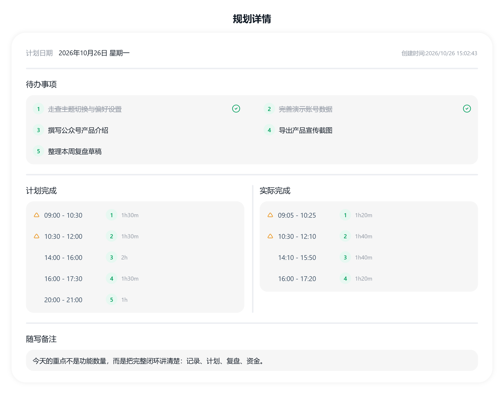
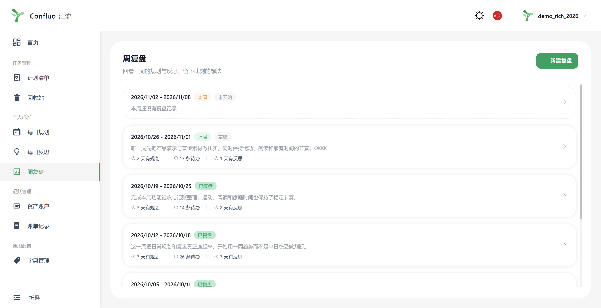
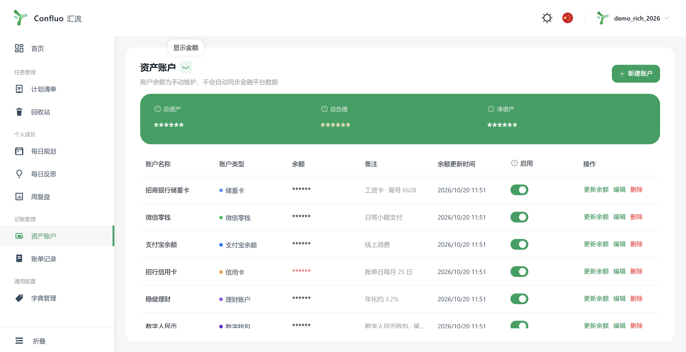
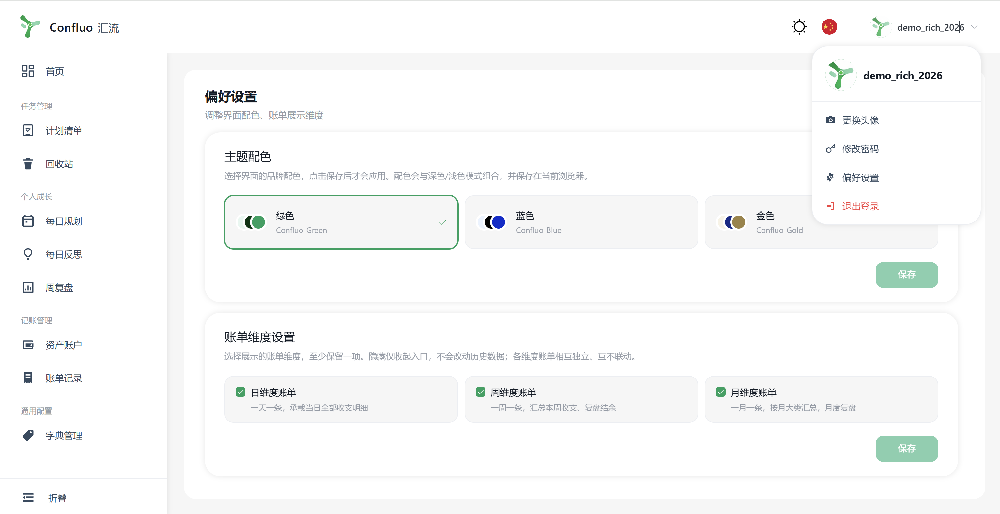

# 我把时间、复盘和钱，放回了同一条生活线

以前我的生活散在四个 App 里：

清单里写着要做什么，日程里放着准备怎么做，日记里留着当时的感受，记账软件里躺着这个月的钱。

每一件都记了，但周末想认真回看时，还是得自己拼图。

这是我最近一直在做的个人管理项目：**Confluo 汇流**。

它不是另一个塞满功能的“万能效率软件”，而是想把计划、行动、反思、复盘和账目，放回同一条能回看的生活线上。

官网已经上线：**confluo.cn**

## 打开首页，先看今天

首页没有先摆出所有功能，而是先回答三个问题：

- 今天有哪些事情在等我？
- 今天原本怎么安排，实际又怎么过？
- 这一周和我的生活底座，正在发生什么变化？

今日任务、当日时间线、本周成长和净资产快照放在同一屏里。

金额默认隐藏。这一点我很喜欢，地铁上、办公室里打开页面，不需要先担心数字被看见。

## 计划与实际，分开记

每日规划分成四块：

- 待办事项
- 计划完成
- 实际完成
- 随写备注

计划与实际各自记录起止时间，用时会自动计算。

比如计划 14:00–15:00 写完方案，实际 14:40 才开始，16:10 才结束。

记录几天以后就会发现：真正的问题常常不是“不够自律”，而是时间估算一开始就太乐观。

详情还能导出成图片，做周报或留档都方便。

## 每天留三条问题给反思

不要求写长篇日记，每条只需要回答：

**发生了什么 → 为什么 → 下次怎么做**

一天可以写多条，也可以只写一条。少写没有惩罚，空一天也不会跳出红色提醒。

反思还有年度视图。到了年底回看，会发现一些原以为已经过去的事，其实一直在重复影响自己。

## 周末不给自己打分

周复盘会自动汇总：

- 这周有几天做了规划
- 每日计划里共有多少条待办
- 计划时长与实际时长
- 有几天写了反思
- 每天分别留下了什么

复盘只问四件事：

做得好的、卡住我的、这周的收获、下周想改变什么。

写不下去可以先存草稿；完成后会冻结当时的统计快照，之后改每日记录，也不会悄悄改写已经完成的复盘。

有些周适合冲刺，有些周只需要恢复。数据是拿来观察的，不是拿来给自己判分的。

## 时间和钱，放在一起看

资产账户可以自己分类：储蓄卡、信用卡、零钱、理财、现金……

总资产、总负债、净资产集中展示；余额需要主动核对，不假装自动同步所有银行数据。

账单支持日、周、月三个独立视角，分类和标签也能按自己的方式维护。

账面不是生活的全部，但看清楚钱和注意力一起流向哪里，确实会让人更踏实一点。

## 不抢眼，但很在意的细节

界面有深色 / 浅色模式，也有绿色、蓝色、金色三套主题。

换配色需要主动保存，不会因为误触突然换掉整个界面；金额默认遮挡；桌面和手机浏览器都做了适配；中文、英文可以切换。

一个人借助 AI 做产品，提高的应该只是实现速度。功能怎么组织、状态怎么反馈、哪里该少一步、哪里该留白，还是得由人一遍遍判断。

我喜欢克制、清楚、有一点自己的审美，也经得起长期使用的工具。

“能用”不是完成，“差不多”也不够。

## 适合谁？

- 工具很多，但信息总是割裂的人
- 想看“计划 vs 实际”的人
- 想开始周复盘，又怕被 KPI 催着跑的人
- 有多个账户，希望同时看流水和资产的人
- 在意分类、标签和记录结构的人

官网：**confluo.cn**

可以从今天的一条计划开始，也可以只写下一句此刻的感受。

记录不是为了把生活活成表格，而是为了更早看见那些真正重要的变化。

**Confluo 汇流：让计划、行动、反思与生活账目，在这里汇流。**

#个人管理 #效率工具 #时间管理 #周复盘 #记账 #独立开发 #产品设计 #数字生活 #自我成长 #生活记录
